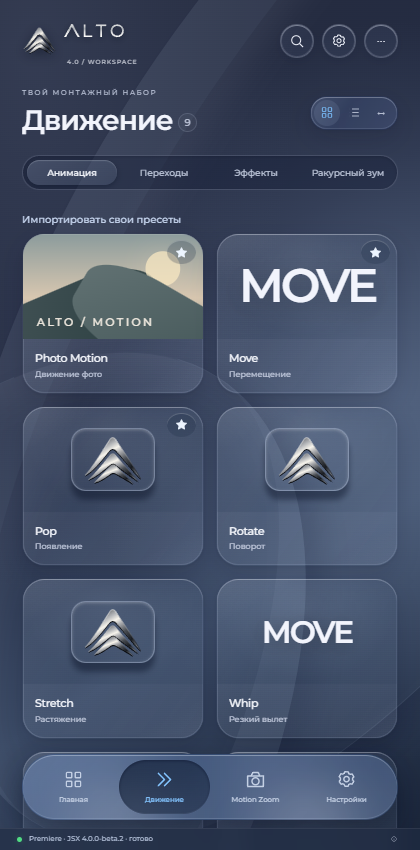

# ALTO 4.0.0-beta.2

CEP-панель для Premiere Pro на основе Montazhopa. Новый интерфейс следует двум пользовательским референсам: полупрозрачное графитовое стекло в духе iOS и знак A из трёх плавных металлических лент. Основной шрифт — локальный Montserrat RU/EN.

[Скачать ALTO 4.0.0-beta.2](https://github.com/jr203pavelvictor-droid/Montazhopa/releases/tag/v4.0.0-beta.2) · [Изменения](docs/ALTO_4_0_CHANGELOG.md) · [Проверки и ограничения](docs/ALTO_4_0_QA.md) · [Инструкция](docs/ALTO_4_0_WORKFLOW_RU.md)



- Хромированный изогнутый знак и открытая A в надписи ALTO; SVG и app icons 16–512 px.
- Стеклянные панели с бликами и глубиной; синие действия, зелёные переключатели, круглые кнопки и ползунки с индикацией значения.
- Главная, поиск по разделам, закреплённые команды, недавнее и сохранение контекста.
- Утверждённый дизайн из design-preview: четыре основных экрана, все прежние разделы через «⋯», ширина 300–960 px.
- Motion Zoom: независимые перелёты, Ease In / Ease Out, drag/reorder/duplicate точек, захват кадра и отдельная привязка целей расфокуса.
- Аудио: waveform всех каналов, In/Out, preview volume, fades и вставка нового WAV-отрезка без изменения исходника.
- Диагностика offline/путей/связей в режиме чтения; тишина с отдельными pads, картой, прослушиванием и исключениями → новая XML-секвенция.
- Сохранены прежние инструменты, CEP ID, настройки, избранное, библиотека, watch folders, ownership/rollback и формат обновлений.

Обновление из прежней панели: Настройки → разрешить интернет и тестовые версии → Проверить → Загрузить и подготовить → Установить после закрытия Premiere. Можно также установить ZIP из Releases. Архив `Source code` не является пакетом обновления.

Публичное имя панели — **ALTO**. Репозиторий, `com.victor.motionviewer`, папка `Montazhopa3` и имя пакета `Montazhopa_<version>.zip` сохранены для совместимости.

[Существующие инструменты](FEATURES.md) · [Ограничения Premiere](docs/ITERATION_1_RU.md) · [Локальная обработка](LOCAL_TOOLS_RU.md) · [Лицензии](THIRD_PARTY_NOTICES.md)

Локальная сборка: `python3 tools/build_release.py`. Проверки браузера требуют Playwright 1.51.1.

```bash
node tests/engine.cjs
node tests/host.cjs
node tests/iteration1.cjs
node tests/frame-capture.cjs
node tests/bridge.test.cjs
node tests/local.cjs
node tests/core.test.cjs
node tests/production-update.cjs
node --test tests/upstream/syncitol.test.cjs
python3 -m unittest discover -s tests -p 'test_*.py'
node tests/ui.cjs
node tests/alto-ui.cjs
node tests/production-ui.cjs
```

Это предварительная версия. Проверки используют настоящий HTML/CSS/Web Audio в Chromium и модель API Premiere. Живая проверка beta.2 в Premiere и нативная установка/откат macOS/Windows не выполнялись; по просьбе пользователя их выполняет он сам. Расфокус поддерживает отдельные клипы/явно подтверждённые отдельные несты объекта со скоростью 100%; общий нест не обеспечивает селективность. Подробности — в QA и инструкции.
